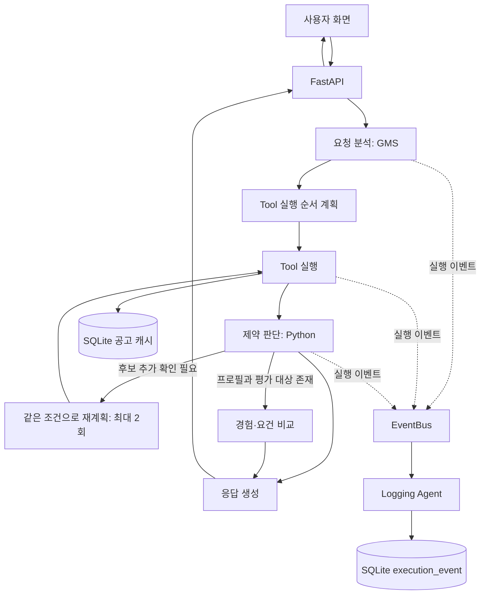

# CareerMate

**경험을 정리하고, 나에게 맞는 공고를 탐색하며, 다음 취업 준비를 계획하는 AI Agent 서비스**

SSAFY AI 코어 프로젝트 3회차 · 작성자/점검자 **김승희** · README 갱신일 **2026-11-20**

CareerMate는 자연어 요청에서 검색 조건을 분석하고, 외부 채용공고와 직무·자격시험 정보를 조회해 취업 준비를 돕습니다. 잡알리오·인크루트 RSS·Greenhouse·Lever를 통합 검색하며, 여러 프로필과 경험을 저장하고 지원 일정을 관리할 수 있습니다. 적합도는 추가 경험을 확인한 뒤 제공하는 참고 정보이며, 서비스의 중심은 경험 정리와 준비 방향 안내입니다.

## 1. 주요 기능

| 기능 | 구현 내용 |
|---|---|
| 통합 공고 검색 | 네 출처를 한 번에 검색하고 출처·원문 링크·조건 미확인 여부 표시 |
| 공통 직무 분류 | IT 요청에 소프트웨어, 데이터/AI, 시스템/인프라, 정보보안, 통신 기준 적용 |
| 중복 공고 제외 | 수집한 인크루트 공고와 같은 Greenhouse·Lever 항목은 검색 결과에서 제외 |
| 여러 프로필 관리 | 이름을 붙인 프로필 저장·선택·수정, 프로필별 기술·자격·경험 관리 |
| AI 경험 정리 | 채팅으로 STAR 경험 초안을 만들고 사용자가 검토한 뒤 저장 |
| 경험 기반 준비 상담 | 현재 경험과 공고 요건 비교, 부족한 정보·추가 경험 확인, 현재·미래 참고 점수 안내 |
| 원문·캡처 입력 | 인크루트 원문 확인 후 모집 기간과 자격·우대사항 입력, PNG/JPG에서 읽은 초안 검토 |
| 준비 계획 관리 | 자연어 일정 초안, 지원 계획 저장·목록·상세·수정·삭제, 시간 충돌 안내 |
| 실행 이력 | 단계·Tool 호출·소요 시간·판단 이유·재계획·오류 표시, 세션별 로그 조회·삭제 |

## 2. 기술 스택

| 구분 | 사용 기술 |
|---|---|
| 실행 환경 | Python 3.12 — 로컬 검증 버전 3.12.10 |
| 서버·스키마 | FastAPI, Uvicorn, Pydantic |
| Agent | LangGraph, LangChain, `ChatOpenAI` |
| LLM | SSAFY GMS, 기본 모델 `gpt-6-luna` |
| 데이터 | SQLite, requests, 공개 API·RSS |
| 사용자 화면 | HTML/CSS/JavaScript, FastAPI 정적 파일 제공 |
| 검증 | unittest, Mock·장애 주입, 실제 외부 API 및 브라우저 검증 |

의존성 버전은 [requirement.txt](requirement.txt)에 고정되어 있습니다. 프론트엔드에 별도 Node.js 설치나 빌드 과정이 필요하지 않습니다.

## 3. 설치 및 실행

아래 명령은 **Windows의 Git Bash**, 프로젝트 루트에서 실행합니다. Python 3.12가 설치되어 있어야 합니다. 다른 폴더에 프로젝트를 받았다면 첫 번째 경로를 변경합니다.

### 3.1. 가상환경·패키지 준비

```bash
cd /c/Users/SSAFY/Desktop/CareerMate

# 처음 설치할 때만 생성합니다. 기존 .venv가 있다면 생략합니다.
python -m venv .venv
source .venv/Scripts/activate
python -m pip install -r requirement.txt

# 기존 키 파일은 덮어쓰지 않습니다.
if [ ! -f .env ]; then cp .env.example .env; fi
```

### 3.2. 환경변수 입력

프로젝트 루트의 `.env`를 열어 발급받은 키를 입력합니다. 실제 키는 저장소·제출 문서·캡처에 포함하지 않습니다.

```dotenv
GMS_API_KEY=
GMS_MODEL=gpt-6-luna
GMS_BASE_URL=https://gms.ssafy.io/gmsapi/api.openai.com/v1
ALIO_API_KEY=
DATA_GO_KR_KEY=

# 선택: 비워 두면 config/job_boards.json 사용
CAREERMATE_JOB_BOARDS_FILE=
```

| 변수 | 용도·준비 방법 |
|---|---|
| `GMS_API_KEY` | [SSAFY GMS](https://gms.ssafy.io/web/)에서 제공받은 키. 대화 분석·응답·경험 정리·캡처 해석에 사용 |
| `GMS_MODEL` | 기본값 `gpt-6-luna`. 해당 모델의 함수 호출을 위해 코드에서 `reasoning_effort=none` 적용 |
| `GMS_BASE_URL` | 기본 OpenAI 호환 GMS 주소. 모델 변경 시 주소도 함께 확인 |
| `ALIO_API_KEY` | [잡알리오 공공데이터](https://opendata.alio.go.kr)의 채용정보 API 이용 신청 후 발급받은 키 |
| `DATA_GO_KR_KEY` | 공공데이터포털의 [NCS 능력단위](https://www.data.go.kr/data/15063879/openapi.do), [Q-Net 시험 일정](https://www.data.go.kr/data/15074408/openapi.do) 활용 신청 및 승인 후 사용 |
| `CAREERMATE_JOB_BOARDS_FILE` | 선택 항목. 국내 기업별 Greenhouse·Lever 게시판 설정 파일 경로 |

Greenhouse·Lever 공개 채용 API와 인크루트 RSS에는 별도 API 키를 사용하지 않습니다. 키가 없어도 프로필·계획·저장된 로그 관리는 가능하며, 키가 필요한 기능은 설정 안내를 표시합니다. 키나 모델을 변경한 뒤에는 서버를 다시 시작합니다. 모델별 설정은 [모델 설정 설명](docs/model_config.md)을 참고합니다.

### 3.3. DB 초기화 및 서버 시작

```bash
python -m backend.app.db.database
python -m uvicorn backend.app.main:app --host 127.0.0.1 --port 8000 --reload
```

| 주소 | 용도 |
|---|---|
| <http://127.0.0.1:8000/> | 사용자 화면 |
| <http://127.0.0.1:8000/docs> | Swagger API 명세·요청 실행 |
| <http://127.0.0.1:8000/openapi.json> | OpenAPI 요청·응답 스키마 |
| <http://127.0.0.1:8000/health> | 서버 상태 — `{"status":"ok"}` |

서버 종료는 실행 중인 터미널에서 `Ctrl+C`입니다. 이후에는 가상환경 활성화 후 Uvicorn 명령으로 다시 실행합니다. 화면이 열리지 않으면 서버 실행 터미널의 오류와 포트 8000 사용 여부를 확인합니다.

별도 Git Bash 터미널에서 동작을 확인할 수 있습니다.

```bash
curl http://127.0.0.1:8000/health

curl -X POST http://127.0.0.1:8000/api/chat \
  -H 'Content-Type: application/json' \
  -d '{"session_id":"submission-demo","message":"서울 IT 공고 4건 찾아줘","job_source":"all","assess_fit":false}'
```

대화 예시는 실제 GMS·외부 출처를 호출하며 공고 캐시와 실행 로그를 저장합니다. 검색 결과는 실행 시점과 외부 제공 범위에 따라 달라집니다.

## 4. 사용자 이용 흐름

1. **프로필 만들기·선택**: 희망 직무·지역·고용형태, 현재 보유 기술·자격을 저장합니다. 여러 프로필을 만들고 상담에 사용할 프로필을 선택할 수 있습니다. 생성 시 경험을 함께 추가하거나 나중에 수정합니다.
2. **경험 정리**: AI 채팅에 프로젝트·활동 경험을 설명하면 STAR 초안을 제공합니다. 사용자가 사실과 사용 기술을 확인하고 저장한 경험을 상담에 반영합니다.
3. **공고 탐색**: `서울 IT 공고 4건 찾아줘`처럼 요청합니다. `지역만 경기로 바꿔줘` 같은 후속 요청은 같은 세션에서 이전 조건을 이어받습니다. 정상 0건이면 추천 검색어 버튼을 제공합니다. 백엔드 검색의 IT 추천은 사용자가 선택한 뒤 실행합니다.
4. **공고 요건 확인**: 공고 카드에서 출처와 원문 링크를 확인합니다. 인크루트는 원문을 읽고 모집 기간·필수·우대사항을 입력합니다. PNG/JPG 캡처로 읽은 내용도 먼저 검토·수정해야 합니다. 모집 기간을 모르면 미확인 또는 채용 시까지를 명시합니다.
5. **경험 기반 상담**: 선택 프로필의 기술·자격·경험과 공고를 비교합니다. 참고 결과가 낮거나 경험 확인이 더 필요하면 점수를 먼저 보여 주지 않고 추가 경험을 질문합니다. 경험을 보완해 다시 검토하거나, 추가 경험이 없다고 답한 뒤 참고 점수와 준비 방향을 확인합니다.
6. **준비 계획**: 성장 계획에 목표 역량·목표일을 등록합니다. 공고 마감 전 완료할 활성 계획은 미래 참고 점수에 반영합니다. 공고 버튼이나 자연어 일정 초안에서 지원 계획 입력 화면으로 가져온 뒤 검토·저장합니다.
7. **계획·실행 기록 관리**: 지원 계획을 조회·수정·삭제하고, 대화의 단계·Tool 호출·재계획·실패 원인을 발생 순서대로 확인합니다. 세션 로그는 조회·삭제를 지원합니다.

점수는 확인 가능한 항목에 대한 규칙 기반 참고 값이며 합격 확률이 아닙니다. 필수조건은 충족·불충족·미확인을 구분하고, 취업지원대상자 등 기타 우대조건은 기술 점수에서 제외합니다. 성장 계획을 완료했더라도 보유 역량을 현재 프로필에 반영하려면 직접 수정해야 합니다.

이미지는 PNG/JPG, 요청당 1~2장, 장당 3MB 이하·합계 5MB 이하로 제한합니다. 캡처 해석·경험 정리에는 입력 내용을 GMS로 전달합니다. 상세 흐름과 입력 제한은 [경험 중심 상담 사용방법](docs/preparation_coaching.md)에 정리되어 있습니다.

### 일정과 날짜 처리

- `내일 오후 2시부터 3시까지 지원서 작성 일정`은 저장 전 초안을 만듭니다. 후속 시간 변경도 이전 조건을 이어받으며, 사용자가 검토 후 저장해야 DB에 반영됩니다. 종료 시각이 없으면 추가 입력을 요청합니다.
- 시간 지정 일정은 화면에서 KST로 입력·표시하고 DB에 UTC로 저장합니다. 날짜만 지정한 마감에는 임의의 시각을 넣지 않습니다.
- 같은 프로필의 취소되지 않은 시간 일정끼리 충돌을 확인합니다. 수정 시 자기 자신은 제외하고, 앞 일정 종료와 뒤 일정 시작이 같은 경우는 충돌하지 않습니다. **충돌이 있어도 저장하고 충돌 목록·경고를 반환합니다.**
- `마감일이 2026년 11월 30일 이후`는 최소 마감일 제약입니다. 특정 과거·미래 날짜 당시의 진행 여부를 묻는 요청과 구분합니다. 과거·미래 시점의 진행 이력은 현재 외부 데이터로 확인할 수 없어 제한을 안내합니다.

## 5. Agent 설계와 실행 로그



위 그림은 주요 경로입니다. 실제 LangGraph는 `analyze → plan → execute → evaluate → respond`를 기본으로, 조건에 따라 `replan`·`assess_fit`으로 분기합니다. 인사와 지원하지 않는 기준일 요청은 Tool 실행 없이 응답합니다. 계획·응답·적합도 등 다른 단계의 진입·종료도 이벤트로 발행합니다.

**AI와 코드의 역할**: GMS는 자연어 의도·조건을 구조화하고 요건·경험을 정리하며 답변을 생성합니다. Python은 Tool 순서·인자 검증, 공통 직무 분류, 날짜 비교, 재계획 상한, 중복 제외, 점수 계산과 DB 처리를 담당합니다. 자격 종목·NCS 코드를 확인하지 못한 경우 임의로 만들어 호출하지 않습니다.

**재계획**: 마감 제약을 만족하는 후보가 부족하고 추가 후보 확인이 가능한 경우, 직무·지역·고용형태 등 조건을 유지하고 후보 수를 10건씩 늘립니다. 기존에 확보한 캐시를 사용하며 최대 2회로 제한합니다. 조건을 자동으로 다른 지역이나 직무로 바꾸지 않습니다.

**로그 분리**: Agent는 정제된 이벤트를 발행하고, 동기식 EventBus 구독자인 Logging Agent가 받은 이벤트를 SQLite에 기록합니다. Logging Agent에는 LLM을 사용하지 않습니다. 구독자가 없거나 로그 저장이 실패해도 대화 실행을 계속하며, 현재 응답의 이벤트 수집은 DB 저장과 독립적입니다. 적합도 단계에서 직접 호출하는 공고 상세 Tool도 같은 경로로 기록합니다.

**추적·보호**: 같은 대화는 `session_id`, 개별 요청은 `run_id`, Tool 호출은 호출 식별자로 구분합니다. 이벤트에는 단계, 순서, 공개 가능한 판단 이유, 상태·건수, 소요 시간을 남깁니다. API 키·토큰, 사용자 요청·프로필 원문, 이미지, Tool 응답 본문·원시 예외는 발행 전에 제외합니다. 실행 로그는 SQLite ID 순서로 조회하며 수정 API는 제공하지 않습니다.

**대화 맥락**: 같은 프로필·출처의 세션에서 변경된 조건만 반영합니다. 맥락은 서버 프로세스 메모리에 보관되어 재시작·자동 reload 시 초기화됩니다. DB에 저장된 실행 로그를 읽는 기능과 대화 맥락 복원은 구분됩니다.

## 6. Tool 및 외부 데이터

| Tool | 역할 | 외부 출처 |
|---|---|---|
| `search_jobs` | 공고 수집·정규화·저장 후 조건 검색, 공통 분류·중복 제외 | 잡알리오, 인크루트 RSS, Greenhouse, Lever |
| `get_job_detail` | 검색에서 얻은 DB 공고 ID로 상세·원문 정보 조회 | 각 출처의 제공 범위에 따름 |
| `search_ncs_skills` | 확인된 8자리 NCS 코드의 능력단위 조회 | 한국산업인력공단 NCS |
| `get_cert_schedule` | 연도·자격 구분과 확인된 종목코드로 시험 일정 조회 | 한국산업인력공단 Q-Net |

Tool은 **4종**입니다. 출처 추가는 검색·상세 Tool의 확장이며 별도 Tool 2종 추가가 아닙니다. 입력 정의와 출력·오류 형식은 [Tool 정의](docs/tools.md), [입력 JSON Schema](docs/tool_input_schemas.json)를 참고합니다. 화면·대화 기본 출처는 `all`이며, 직접 `search_jobs`를 호출할 때의 기본 `source`는 기존 호환을 위해 `alio`입니다.

### 수집 범위와 검색 기준

| 출처 | 현재 범위·정책 |
|---|---|
| 잡알리오 | 키로 진행 공고 목록을 전체 페이지 조회해 갱신. 정상 전체 수집 후 목록에서 사라진 해당 출처 공고만 종료 처리 |
| 인크루트 RSS | 공개 RSS의 일반·IT·의료 분야 최신 제공분. 15분 캐시 사용. RSS에서 사라졌다는 이유만으로 종료 처리하지 않음 |
| Greenhouse | 기본 국내 기업 크래프톤. `krafton` 게시판에서 KRAFTON 메타데이터 범위 사용 |
| Lever | 기본 국내 기업 하이퍼커넥트. `matchgroup` 게시판에서 Hyperconnect 사업부만 사용 |

Greenhouse·Lever 대상은 [config/job_boards.json](config/job_boards.json)의 **국내 기업 허용 목록**으로 관리합니다. 설정된 기업의 공개 공고를 수집하며 국내 기업 전체를 검색하는 구조는 아닙니다. 국내 기업의 해외 근무 공고가 포함될 수 있어 근무 지역은 사용자 조건으로 별도 판단합니다. 두 출처는 게시판별 15분 캐시를 사용하며, 수집 성공 시 해당 게시판·기업 범위에서만 상태를 갱신합니다.

IT 분류는 네 출처에 같은 기준을 적용합니다. 공고 제목에 직무 표현이 일치한 후보를 먼저 표시하고, NCS·RSS 분야만 일치하면 ‘분야 관련 후보 · 직무 확인 필요’로 표시합니다. 기업 이름만으로 IT 직무라고 판단하지 않습니다. 백엔드처럼 구체적인 검색어를 전체 IT로 자동 확대하지 않습니다. 공통 기준을 적용해도 출처마다 제공 범위가 달라 결과 건수가 같아지지는 않습니다. [공통 검색 기준](docs/search_alignment.md)

인크루트 RSS의 모집 기간·상세 자격·진행 상태는 미확인일 수 있어 원문 확인과 사용자 입력이 필요합니다. Greenhouse·Lever도 없는 마감일·자격·경력은 미확인으로 유지합니다. `Full-time`만으로 정규직이라고 단정하지 않으며, 조건을 확인하지 못한 참고 후보는 별도 표시합니다. [RSS 설명](docs/incruit_rss.md), [국내 ATS 출처 설명](docs/ats_sources.md)

### 인크루트와 중복되는 ATS 공고 처리

- 현재 검색 결과의 일부가 아닌 **최근 성공적으로 수집한 RSS 스냅샷**을 비교 기준으로 사용합니다.
- 동일한 공고 원문 URL·식별자, 또는 정규화한 회사명·공고명과 충돌하지 않는 지역 정보로 중복을 판정합니다. 기업 별칭을 반영하되 다른 직급·팀·지역·회사의 공고는 임의로 합치지 않습니다.
- 중복이면 인크루트 항목을 남기고 Greenhouse·Lever 항목을 검색 결과에서 제외합니다. 제외 후 고유 공고로 요청 건수를 채웁니다. 기존 계획·평가 연결을 보존하기 위해 DB 행 자체를 삭제하지 않습니다.
- RSS 조회 실패로 비교 기준을 확보하지 못하면 추가 ATS 출처 노출을 보류하고 `DEDUP_REFERENCE_UNAVAILABLE`을 안내합니다. 처리 가능한 다른 출처의 결과는 계속 제공합니다.
- 비교는 **수집한 RSS 범위**에 한정됩니다. 인크루트 사이트 전체와의 중복이나 제목이 크게 다른 번역 공고까지 동일하다고 보장하지 않습니다.

외부 제공 데이터의 이용 조건은 각 제공처 기준을 따릅니다. 원문 링크로 최종 요건·모집 기간을 확인하며, RSS 제공 자체를 상세 본문 재수집·재배포 허락으로 간주하지 않습니다. 공식 참고: [인크루트 RSS](https://people.incruit.com/rss/rss.asp), [Greenhouse Job Board API](https://developers.greenhouse.io/job-board.html), [Lever Postings API](https://github.com/lever/postings-api).

### 정상 0건과 오류 구분

| 상황 | 처리·표시 |
|---|---|
| 정상 검색 결과 0건 | `NO_RESULT`, ‘검색 결과 0건’과 추천 검색어 안내 |
| 마감 제약 없음 | 마감 판단은 `not_requested`. 마감 조건 미충족으로 표시하지 않음 |
| 실제 최소 마감일 제약 미충족 | 확인한 마감일과 조건을 비교해 `unmet`, 마감일 미확인은 `unknown` |
| 외부 호출·Tool 실패 | 출처·호출별 오류 표시. 정상 0건으로 변환하지 않음 |
| 일부 출처 실패 | 출처별 상태와 사용할 수 있는 결과를 함께 안내 |
| 로깅 저장 실패 | 대화 처리 계속, 현재 응답의 실행 이력은 별도 전달 |

## 7. 주요 API

요청·응답의 실제 타입과 제약은 서버의 `/docs` 및 `/openapi.json`을 기준으로 확인합니다.

| Method | 경로 | 기능 |
|---|---|---|
| GET | `/health` | 서버 상태 |
| POST | `/api/chat` | 대화·통합 검색·경험 기반 상담·일정 초안·현재 실행 이벤트 |
| GET, POST | `/api/profiles` | 프로필 목록·등록 |
| GET, PUT | `/api/profiles/{profile_id}` | 프로필 상세·수정 |
| GET, POST | `/api/profiles/{profile_id}/experiences` | 해당 프로필 경험 목록·등록 |
| PUT, DELETE | `/api/profiles/{profile_id}/experiences/{experience_id}` | 경험 수정·삭제 |
| POST | `/api/experience-coach` | 경험 정리 채팅·검토할 STAR 초안 |
| POST | `/api/requirements/capture` | 공고 캡처에서 읽은 검토용 초안 |
| GET, POST | `/api/growth-plans` | 성장 계획 목록·등록 |
| DELETE | `/api/growth-plans/{growth_id}` | 성장 계획 삭제 |
| GET, POST | `/api/plans` | 지원 계획 목록·등록 |
| GET, PATCH, DELETE | `/api/plans/{plan_id}` | 지원 계획 상세·수정·삭제 |
| GET | `/api/logs` | 세션별 실행 로그 목록 |
| GET, DELETE | `/api/logs/{session_id}` | 발생 순서 로그 상세·세션 로그 삭제 |

`GET /api/growth-plans`, `GET /api/plans` 및 단건 계획 조회·수정·삭제, 성장 계획 삭제에는 `profile_id` 쿼리 파라미터를 사용합니다. 생성 요청에는 본문에 프로필 ID를 넣습니다. 계획 저장·수정 응답은 `{plan, conflicts, warning}`이며 충돌이 있어도 저장합니다.

대화는 같은 `session_id`로 후속 요청을 보냅니다. `job_source`는 `all/alio/incruit/greenhouse/lever`를 지원하며 응답에 `run_id`, `jobs`, `source_results`, `events`, `search_suggestions`, `plan_draft`, `fit_follow_up` 등을 제공합니다. HTTP 오류의 공통 본문은 `{"error":{"code":"...","message":"..."}}`이며, 대화 오류에는 추적 식별자·실행 이벤트가 추가될 수 있습니다.

## 8. 데이터 저장과 프로젝트 구조

SQLite 파일은 프로젝트 루트의 `careermate.sqlite3`입니다. [schema.sql](backend/app/db/schema.sql)에 정의한 테이블은 **8개**입니다.

| 테이블 | 용도 |
|---|---|
| `user_profile` | 이름·희망 조건·현재 기술·자격 |
| `experience` | 프로필별 경험·STAR 내용·사용 기술 |
| `growth_plan` | 목표 역량과 목표일 |
| `job_posting` | 출처 식별자·공고·제공된 상세 정보 |
| `application_plan` | 날짜 마감·시간 지정 준비 일정 |
| `match_result` | 현재·미래 참고 점수와 요건 판단 |
| `execution_event` | 세션·실행별 순서 있는 실행 이벤트 |
| `job_source_snapshot` | 출처별 수집 성공 시점·스냅샷 상태 |

초기화 명령은 테이블을 생성하며 기존 테이블을 삭제하지 않습니다. 일부 이전 DB 호환 컬럼은 해당 서비스를 처음 사용할 때 추가됩니다. CLI의 `--demo-fit`은 예시 프로필·평가를 롤백하고, `--profile-id`는 실제 프로필 평가 저장 경로를 사용합니다. 데모 실행에서도 공고 캐시와 실행 로그는 저장될 수 있습니다.

```text
CareerMate/
├── backend/app/
│   ├── main.py                   # FastAPI·정적 화면·공통 오류 처리
│   ├── career_agent.py           # LangGraph·요청별 실행
│   ├── chat_*.py                 # 대화 스키마·API·세션 처리
│   ├── workspace_*.py            # 프로필·경험·계획 API와 저장
│   ├── coaching_api.py           # 경험 정리·공고 캡처 입력
│   ├── job_fit.py                # 참고 점수·요건 판단
│   ├── match_service.py          # 경험·공고 비교와 평가 저장
│   ├── job_taxonomy.py           # 공통 직무 분류
│   ├── ats_sources.py            # 기업별 ATS 수집·캐시
│   ├── job_dedup.py              # 인크루트와 ATS 중복 판정
│   ├── execution_events.py       # 정제된 이벤트 발행·EventBus
│   ├── logging_agent.py          # 이벤트 구독·SQLite 저장
│   ├── log_*.py                  # 로그 목록·상세·삭제
│   ├── db/                       # 스키마·연결·공고 검색·호환 처리
│   ├── tools/                    # 등록된 Tool 4종
│   └── integrations/             # GMS·잡알리오·RSS·Greenhouse·Lever
├── frontend/                     # index.html·style.css·app.js
├── config/job_boards.json         # 국내 기업 게시판·별칭·필터
├── docs/                         # Tool·출처·모델·사용 흐름 설명
├── test/                         # 회귀 테스트·별도 실제 API 검증 스크립트
├── outputs/                      # 기존 제출 산출물·검증 자료
├── .env.example                  # 환경변수 양식
├── .gitignore
├── requirement.txt
└── README.md
```

## 9. 필수 요구사항과 구현 위치

| 요구사항 | 현재 구현 근거 |
|---|---|
| F3001~F3011 — Tool·Agent 실행 | Tool 4종, 외부 데이터 조회, 의도 분석·계획·순차 실행·제약 계산·재계획·맥락 유지·응답. `tools/`, `integrations/`, `career_agent.py`, `chat_service.py` |
| F3012 — 실행 이벤트 | 단계 진입·종료, Tool 요청·응답·시간, 판단 이유·재계획·오류. `execution_events.py` |
| F3013 — Logging Agent | 발행과 저장 분리, 동기 구독, 저장 실패 시 대화 지속. `logging_agent.py` |
| F3014 — 로그 관리 | 세션 목록·발생 순서 상세·삭제, 수정 기능 없음. `log_api.py`, `log_service.py` |
| F3015~F3016 — 준비 계획 | 생성 계획 검토·저장·목록·상세·수정·삭제, 겹치는 일정 저장 및 충돌 안내. `workspace_*.py` |
| F3017 — API | FastAPI 요청·응답 스키마, 공통 오류, Swagger. `main.py`, 각 API·스키마 모듈 |
| F3018~F3019 — 화면 연동 | 상담·프로필·계획·로그 화면, 실행 순서·재계획·처리 중·실패·키 누락 안내. `frontend/` |

인크루트·국내 ATS 확장, 공통 검색 분류, 여러 프로필, 경험 정리·이미지 입력은 추가 구현 기능입니다. Vector DB 기반 RAG, Google Calendar 연동, LLM 기반 다중 Agent 협업은 현재 구현 범위에 포함하지 않습니다. Logging Agent는 이벤트 구독·저장 역할입니다.

## 10. 검증 방법과 결과

**최근 기능 검증 기준일: 2026-11-20. 지정 회귀 테스트 10개 파일, 총 219개 통과.** 아래 자동 테스트는 Mock·임시 DB와 장애 주입을 사용합니다. 실제 외부 API 검증과 구분합니다.

| 테스트 파일 | 테스트 수 | 주요 검증 |
|---|---:|---|
| `test_execution_logging.py` | 22 | 단계·Tool 이벤트, 세션/실행 구분, 재계획·실패, 민감정보 제외, 로깅 실패 격리 |
| `test_job_refresh.py` | 7 | 외부 공고 갱신·캐시·실패 처리 |
| `test_log_api.py` | 17 | 로그 세션 목록·상세·순서·삭제·오류 |
| `test_workspace_ui.py` | 25 | 프로필·계획·충돌·API·화면 연동 |
| `test_request_remediation.py` | 18 | 기준일과 마감 제약 구분·자연어 일정 초안 |
| `test_incruit_extension.py` | 26 | RSS 수집·정규화·원문 요건 입력·통합 검색 |
| `test_coaching_features.py` | 32 | 여러 프로필·경험·추가 질문·STAR·캡처 검토 |
| `test_gms_model.py` | 6 | 모델·GMS 주소·함수 호출 호환 설정 |
| `test_search_alignment.py` | 28 | 공통 직무 분류·오탐 방지·분야 후보·정렬 |
| `test_ats_extension.py` | 38 | 국내 기업 범위·전체 수집·중복 제외·실패·미확인 조건 |
| **합계** | **219** | **모두 통과** |

프로젝트 루트에서 가상환경을 활성화하고 파일을 지정해 실행합니다. `-B`는 실행 중 `.pyc` 캐시 파일을 새로 쓰지 않도록 하는 옵션입니다.

```bash
python -B -m unittest discover -s test -p "test_execution_logging.py" -v
python -B -m unittest discover -s test -p "test_job_refresh.py" -v
python -B -m unittest discover -s test -p "test_log_api.py" -v
python -B -m unittest discover -s test -p "test_workspace_ui.py" -v
python -B -m unittest discover -s test -p "test_request_remediation.py" -v
python -B -m unittest discover -s test -p "test_incruit_extension.py" -v
python -B -m unittest discover -s test -p "test_coaching_features.py" -v
python -B -m unittest discover -s test -p "test_gms_model.py" -v
python -B -m unittest discover -s test -p "test_search_alignment.py" -v
python -B -m unittest discover -s test -p "test_ats_extension.py" -v
```

`test/`에는 import 시 실제 API를 호출하는 수동 검증 스크립트도 있으므로 전체 파일을 무조건 discovery 하지 않습니다.

별도 실제 검증에서는 GMS와 네 공고 출처를 연결한 통합 대화, 공고·출처별 상태 반환, 실행 로그를 확인했습니다. 중복 제외·실패·일정 충돌 등 재현 조건이 필요한 사례는 테스트 데이터와 장애 주입으로 검증했습니다. 실제 통합 조회에서 중복이 0건이었다는 사실과 중복 제거 로직 검증은 구분합니다. 화면은 통합 검색·출처·중복 제외 이력·모바일 표시를 확인했습니다.

CLI에서도 같은 세션의 후속 요청을 확인할 수 있습니다.

```bash
python -m backend.app.career_agent \
  "강원 지역 정규직 약사 공고를 1건 찾아줘." \
  --follow-up "지역만 서울로 바꿔줘." \
  --session-id submission-cli
```

수동 확인 시에는 정상 0건, 실제 Tool 오류, 마감 제약 미충족을 각각 확인합니다. 실제 API의 제공 범위·응답·모델 가용성 변화는 자동 테스트 통과와 별개입니다. `outputs/`의 기존 PDF·체크리스트·캡처는 각각 작성 당시의 검증 자료이며, 이 README는 이후 검색 확장까지 포함한 현재 구현을 설명합니다.

## 11. 실행 범위와 제출 시 정리

- 단일 worker의 로컬 교육용 서비스를 기준으로 합니다. 로그인·사용자 인증은 없으며 `profile_id`는 데이터 구분에 사용합니다. 여러 사용자가 접속하는 공개 서비스용 인증·권한 체계는 별도 구현이 필요합니다.
- 대화 맥락·진행 중 상담 상태는 프로세스 메모리, 프로필·경험·공고·계획·실행 기록은 SQLite에 저장합니다. 서버 재시작 후 저장된 로그를 자동으로 대화 맥락으로 복원하지 않습니다.
- 실제 키가 있는 `.env`, `.venv/`, `__pycache__/`, `*.pyc`, 로컬 로그, 개인 정보가 들어 있는 `careermate.sqlite3`는 제출·공유 대상에서 제외합니다. 재현용 환경변수 양식은 `.env.example`, 테이블 생성은 스키마·초기화 명령을 사용합니다.
- **프로젝트의 `__pycache__` 폴더와 `.pyc`는 로컬에서도 삭제해도 됩니다.** `.py` 원본이 있으므로 다음 모듈 실행 시 필요한 캐시가 다시 만들어집니다. 코드·프로필·공고·일정 DB 데이터에는 영향이 없습니다. 현재 `.gitignore`에도 캐시 제외 규칙이 있습니다. [Python 공식 설명](https://docs.python.org/3/tutorial/modules.html#compiled-python-files)

